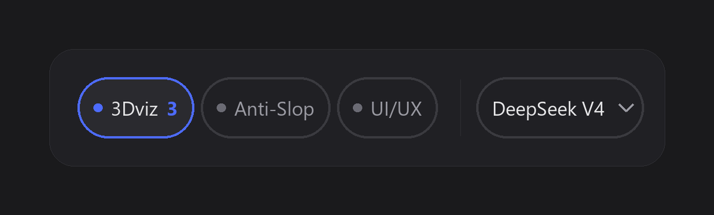

# dsh-mastery

Three chips in the DeepSeek Harness composer, immediately left of the model selector. Each chip
is a **per-chat switch** for one bundle of agent skills: click it and those skills appear in *this
conversation's* `<available_skills>` catalog, so the model can load them with the built-in `skill`
tool; click again and they are gone. Nothing is global, nothing is copied, and the count next to a
chip is the number of times the model actually pulled a skill body in this chat.

Each chip also answers a second question: **has the skill source changed upstream?** The number in
the arrow (`↑2`) is how many commits the bundle's git clone is behind its upstream as of the last
fetch. A background check keeps that fresh; `skill_rail` can fetch on demand and fast-forward.



> The image above is an illustration drawn by [`docs/rail.py`](docs/rail.py), not a screenshot of a
> live GUI.

## What it does

| Piece | Behaviour |
| --- | --- |
| **Chips** | One per bundle, in `conversation.input.right`, order 10 (left of the model picker). |
| **Toggle** | Registers/unregisters every skill of a bundle into that agent's skill layer. The change is visible to the model on its next step, not the next session. |
| **Count** | Increments only when the `skill` tool really returns a body — proof of use, not proof of visibility. |
| **`↑N`** | Commits behind upstream after the last `git fetch`. Hidden when level, when the source is not a git clone, or when checking failed (the tooltip says why). |
| **Persistence** | Which bundles are on is stored per session in `state.json`; reopening a chat restores its switches. |

The host never copies skills into the plugin. A bundle *is* a directory — typically somebody
else's repository clone — and the plugin reads the `SKILL.md` files from there at mount and after
every update.

## Install

Requires the DeepSeek Harness desktop/web GUI and Node ≥ 22. The plugin has no dependencies.

From GitHub, in the harness profile directory:

```bash
dsh plugin --profile desktop add github:santera-pixel/dsh-mastery
```

From a local checkout (this is how it was developed):

```bash
dsh plugin --profile desktop add link:/absolute/path/to/dsh-mastery
```

`dsh plugin <args>` forwards to pnpm inside the profile directory. If your profile does not pick
the bundle up automatically, add `dsh-mastery` to the `dsh.profile.bundles` array in
`~/.dsh/profiles/<profile>/package.json` — that array is what the loader reads, and
[`cordis.patch.yml`](cordis.patch.yml) is the row it inserts.

The plugin id cannot hot-load: **restart the harness** after installing, then reload the GUI tab.

## Configure the sources

On first mount the plugin writes `~/.dsh/mastery/config.json`. Only the `root` paths matter; point
them at any clone of a skills repository:

```json
{
  "version": 1,
  "updates": { "autoCheck": true, "autoPull": false, "intervalHours": 6, "timeoutSeconds": 60 },
  "bundles": [
    {
      "id": "antislop",
      "label": "Anti-Slop",
      "title": "Anti-Slop",
      "blurb": "The core filter plus its code, copy, layout, UI and human-writing variants",
      "root": "C:/Users/you/.dsh/mastery/sources/Anti-Slop"
    }
  ]
}
```

Defaults look for these three clones under `<DSH_HOME>/mastery/sources/`; setting
`DSH_MASTERY_SOURCES` overrides the base directory for all of them:

```bash
git clone https://github.com/viettranx/3dviz-pro-max           "$DSH_HOME/mastery/sources/3dviz-pro-max"
git clone https://github.com/miqdadbadjuber/Anti-Slop          "$DSH_HOME/mastery/sources/Anti-Slop"
git clone https://github.com/nextlevelbuilder/ui-ux-pro-max-skill "$DSH_HOME/mastery/sources/ui-ux-pro-max-skill"
```

An existing `config.json` always wins over the defaults, so an install that already points at
clones elsewhere is never moved.

## Do the skills update themselves?

**No.** The three sources are ordinary git clones on disk; the plugin reads them and never
rewrites them on its own. What it does instead:

- on mount (and every `intervalHours`, default 6) it runs `git fetch` per bundle — network only,
  no working-tree writes — and stores the result in `~/.dsh/mastery/updates.json`, so the `↑N`
  arrows survive a restart;
- `skill_rail` with `action=updates` fetches right now and reports each bundle in words;
- `skill_rail` with `action=update` (optionally `bundle: "antislop"`) runs
  `git pull --ff-only --no-rebase` and immediately re-registers the new text for every live
  session, so the model reads the new version at its next toggle.

Fast-forward only, on purpose: these are somebody else's clones, and a merge commit or a rebase
would rewrite their history. If the branches have diverged the pull fails and reports which bundle
and why; nothing is forced.

`autoPull` is off by default because a fast-forward silently changes what the model will read on
the next chip press. Turn it on in `config.json` if you would rather have that happen by itself.
`autoCheck` is on by default — a stale arrow is worse than none.

## Tool and HTTP surface

The `skill_rail` tool (available to the model) and the `/dsh-mastery` routes (used by the chips)
share one state object.

| Tool call | Route | Effect |
| --- | --- | --- |
| `skill_rail` `{action:"status"}` | `GET /dsh-mastery/state?sessionId=…` | Bundles, their skills, switches, load counts, source status. A stale cache triggers a background check. |
| `skill_rail` `{action:"enable", bundle:"uiux"}` | `POST /dsh-mastery/toggle` | Register/remove one bundle for one session. |
| `skill_rail` `{action:"updates"}` | `POST /dsh-mastery/updates/check` | `git fetch` every bundle, save the result. |
| `skill_rail` `{action:"update", bundle?}` | `POST /dsh-mastery/updates/pull` | Fast-forward one bundle (or all), re-register live sessions. |
| — | `GET /dsh-mastery/updates` | Cached status, no network. |
| — | `GET /dsh-mastery/health` | Plugin id, store directory, bundle count. |

`status` output, one block per bundle:

```
ON   3Dviz (3dviz) — 1 skill: 3d-scene-builder · body loaded 2×
      source: up to date with origin/main @ d077e0e (2026-09-11), 12 edited files locally
off  Anti-Slop (antislop) — 6 skills: antislop, antislop-code, … · never loaded
      source: 4 commits behind origin/main @ 41b85ed (2026-11-10)
```

## How it works

1. **Discovery** walks each bundle root (depth 6, 8 000 files, skipping `node_modules`, `.git`,
   `dist`, …), parses YAML frontmatter and keeps the body in memory.
2. **Activation** resolves the live agent for the session (`agents.get(id)`), reaches its skill
   registry (`ctx.scope.get('skills')`), and calls `skills.register(...)` with a disposer stored
   for that session. The shipped `skill` tool reads the same registry with `scope: exec.agent`,
   which is why a registered skill becomes loadable and appears in the catalog.
3. **Counting** listens on the harness `tools/result` feed: a `skill` result whose name belongs to
   an enabled bundle increments that session's counter. The listener is synchronous and cheap.
4. **Updates** live in [`lib/git.js`](lib/git.js) — the only file that shells out to git — with
   `GIT_TERMINAL_PROMPT=0` so a missing credential can never block a turn.

State lives in `~/.dsh/mastery/`: `config.json`, `state.json`, `updates.json`. An install upgrading
from the tool's earlier name moves `~/.dsh/skillrail/` into place on first mount; if both
directories exist the old one is left untouched and a note is logged.

## Permissions and safety

- Reads any directory you put in `config.json`, and runs `git fetch`/`git pull --ff-only` inside it.
- Never pushes, never force-updates, never deletes, never writes skill bodies.
- Network access is limited to `git fetch` (and only when `autoCheck` is on, or you ask).
- Bounded: 512 KiB per `SKILL.md`, 256 KiB per body, 8 000 files per walk, 60 s per git call.

## Development

```bash
node selfcheck.mjs      # frontmatter parsing + the three bundles' skill names (skips missing clones)
node tests/updates.mjs  # describeUpdate, settings merge, lib/git.js against a throwaway repo
npm pack --dry-run      # what ships
```

Both suites run in CI on every push, and CI also asserts that the packed tarball contains the
runtime files and no tests, and that the packed entry point still exports `apply()`.

## Compatibility

Built against the DeepSeek Harness `desktop` profile (Cordis plugin API: `webServer`, `skills`,
`agents`, `tools`, `workingDirectory`). Requires a profile that exposes the Web GUI and the shipped
`skill` tool. MIT licensed.
